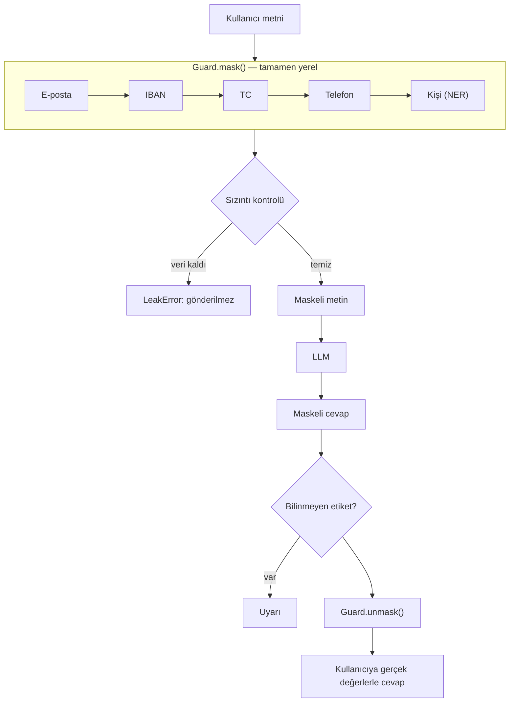

# kvkk-guard

**LLM'lere gönderilen metinlerdeki Türkçe kişisel verileri, metin bilgisayardan çıkmadan önce maskeleyen ve LLM'in cevabında geri açan Python katmanı.**

```python
from openai import OpenAI
from kvkk_guard import GuardedClient

llm = OpenAI(base_url="http://localhost:11434/v1", api_key="ollama")  # veya OpenAI()
client = GuardedClient(llm, model="qwen2.5:7b")

print(client.chat("Selin Arslan'ın 12345678950 numaralı başvurusu için kibar bir yanıt yaz."))
# LLM'e giden:   "[KISI_1]'ın [TC_1] numaralı başvurusu için kibar bir yanıt yaz."
# Kullanıcıya:   "Sayın Selin Arslan, 12345678950 numaralı başvurunuz ..."
```

---


## Problem

Şirketlerde çalışanlar LLM'leri her gün kullanıyor: müşteri şikâyetini özetletmek, e-postaya cevap taslağı yazdırmak, toplantı notunu düzenletmek. Bu metinlerin çoğunda kişisel veri var:

> *"Müşterimiz Selin Arslan (TC: 12345678950) geçen ay TR33 0006 1005 1978 6457 8413 26 numaralı hesabına yapılması gereken iadenin gelmediğini bildirdi. 0532 123 45 67 numarasından dönüş bekliyor."*

Bu metin olduğu gibi bir bulut LLM'ine gönderildiğinde isim, TC kimlik numarası, IBAN ve telefon numarası şirket dışına çıkmış olur. Bankacılık, sağlık ve sigorta gibi sektörlerde bu ciddi bir veri koruma riski.

## Çözüm

`kvkk-guard`, uygulama ile LLM arasına giren ince bir katman:

1. Metindeki kişisel verileri **bilgisayarınızda** tespit eder (regex, sağlama algoritmaları ve yerel çalışan bir Türkçe NER modeli).
2. Her değeri `[KISI_1]`, `[TC_1]` gibi bir etiketle değiştirir ve eşleşmeyi yalnızca bellekte tutar.
3. Maskelenmiş metni LLM'e gönderir.
4. LLM'in cevabındaki etiketleri gerçek değerlerle değiştirip kullanıcıya verir.

LLM hiçbir aşamada kişisel veriyi görmez; kullanıcı ise sanki maskeleme hiç yokmuş gibi gerçek değerlerle dolu bir cevap okur.

## Hızlı başlangıç

### Kurulum

```bash
pip install git+https://github.com/edpolat/kvkk_guard.git
```

İsim tespiti için kullanılan NER modeli ilk kullanımda Hugging Face'ten otomatik indirilir (~735 MB) ve sonraki çalıştırmalarda bilgisayardaki kopyası kullanılır.

LLM'e bağlanmak için ayrıca `openai` kütüphanesi gerekir (paketin kendisi buna bağımlı değildir):

```bash
pip install openai
```

### Yerel model ile deneme (ücretsiz, model indirildikten sonra internet gerektirmez)
```bash
brew install ollama            # macOS; diğer sistemler için ollama.com
brew services start ollama
ollama pull qwen2.5:7b
```

```python
from openai import OpenAI
from kvkk_guard import GuardedClient

client = GuardedClient(
    OpenAI(base_url="http://localhost:11434/v1", api_key="ollama"),
    model="qwen2.5:7b",
    system_prompt="Sen bir bankanın müşteri temsilcisisin.",
)

print(client.chat(
    "Merhaba, ben Selin Arslan. TC kimlik numaram 12345678950. "
    "İadem gelmedi, bana 0532 123 45 67 numarasından ulaşabilirsiniz."
))
```

---

## Tespit edilen veriler

| Veri | Yöntem | Doğrulama | Etiket |
|---|---|---|---|
| TC kimlik no | Regex | 10. ve 11. hane sağlama algoritması | `[TC_1]` |
| IBAN (TR) | Regex, boşluklu ve bitişik yazım | ISO 13616 mod 97 kontrolü | `[IBAN_1]` |
| E-posta | Regex | — | `[EPOSTA_1]` |
| Telefon | Regex: `+90`, `90`, `0`, parantezli, tireli, boşluklu | Alan/operatör kodu 2-5 ile başlamalı | `[TELEFON_1]` |
| Kişi adı | Türkçe NER modeli (yerel) | Model güven skoru | `[KISI_1]` |

### Neden sadece regex değil?

Metinde geçen her 11 haneli sayı TC kimlik numarası değildir; sipariş, fatura veya müşteri numarası olabilir. Bunları da maskelemek gereksiz bilgi kaybına yol açar. Bu yüzden TC kimlik no ve IBAN için önce regex ile aday değerler bulunur, sonra matematiksel sağlama hesabıyla gerçekten geçerli olanlar ayıklanır.

<details>
<summary><b>TC kimlik no algoritması</b></summary>

Örnek: `10000000146`

| Hane | 1 | 2 | 3 | 4 | 5 | 6 | 7 | 8 | 9 | 10 | 11 |
|---|---|---|---|---|---|---|---|---|---|---|---|
| Değer | 1 | 0 | 0 | 0 | 0 | 0 | 0 | 0 | 1 | 4 | 6 |

- 11 hane olmalı, ilk hane 0 olamaz.
- Tek haneler toplamı (1, 3, 5, 7, 9): `1 + 0 + 0 + 0 + 1 = 2`
- Çift haneler toplamı (2, 4, 6, 8): `0`
- 10. hane: `(2 × 7 − 0) mod 10 = 4` ✓
- 11. hane: `(ilk 10 hanenin toplamı) mod 10 = 6 mod 10 = 6` ✓

</details>

<details>
<summary><b>IBAN mod 97 algoritması</b></summary>

Örnek: `TR33 0006 1005 1978 6457 8413 26`

1. Boşluklar silinir, büyük harfe çevrilir. TR IBAN'ı 26 karakter olmalı.
2. İlk 4 karakter (`TR33`) sona taşınır: `0006100519786457841326TR33`
3. Harfler sayıya çevrilir (A=10 … Z=35; T=29, R=27): `000610051978645784132629 2733`
4. Ortaya çıkan 26 haneli sayının 97'ye bölümünden kalan **1** ise IBAN geçerlidir.

Python'da tamsayılar sınırsız büyüklükte olduğu için bu hesap doğrudan `int(...) % 97` ile yapılabilir.

</details>

<details>
<summary><b>Desteklenen telefon yazımları</b></summary>

```
0532 123 45 67
05321234567
+90 532 123 45 67
+905321234567
(0212) 555 12 34
0212-555-12-34
```

Türkiye'de cep telefonu numaraları 5 ile, sabit hatlar 2, 3 veya 4 ile başladığı için alan kodu `[2-5]` ile sınırlandırılmıştır. Bu sayede 1 ile başlayan TC kimlik numaraları telefon sanılmaz.

</details>

---

## Nasıl çalışır?



### Maskeleme adımları

**1. Dedektörler sırayla çalışır.** Her dedektör bir öncekinin maskelediği metni görür. Sıra bilinçli seçilmiştir:

| Sıra | Dedektör | Neden bu sırada? |
|---|---|---|
| 1 | E-posta | `ayse.0532@...` gibi adreslerdeki rakamlar telefon sanılmasın |
| 2 | IBAN | Boşluklu IBAN'daki 4'lü rakam grupları telefon sanılmasın |
| 3 | TC | IBAN'dan sonra, telefondan önce |
| 4 | Telefon | Kalan sayılar |
| 5 | Kişi (NER) | Model, sayıların zaten `[TC_1]` olduğu temiz metni görür |

**2. Her değer bir etiket alır.** Üç sözlük tutulur:

```python
mapping  = {"[TC_1]": "12345678950"}   # geri açmak için
reverse  = {"12345678950": "[TC_1]"}   # aynı değere aynı etiketi vermek için
counters = {"TC": 1}                    # her tür için numara saymak için
```

Aynı değer metinde (veya sohbet boyunca) tekrar geçerse aynı etiketi alır. Böylece LLM, `[KISI_1]`'in her yerde aynı kişi olduğunu anlar.

**3. Değiştirme kelime sınırına dikkat eder.** `Can` adı maskelenirken `Canan` kelimesi bozulmaz (bkz. [Güvenlik önlemleri](#güvenlik-önlemleri)).

**4. Uzun isimler önce maskelenir.** NER modeli `Cansu Erdem` ve daha sonra geçen `Cansu`'yu bulursa, önce `Cansu Erdem` maskelenir. Ters sırada olsaydı metin `[KISI_1] Erdem` olur ve soyadı sızardı.

### Sohbet geçmişi

LLM'ler önceki mesajları kendiliğinden hatırlamaz; her istekte tüm konuşma baştan gönderilir. `GuardedClient` bu geçmişi **maskeli** saklar. Kullanıcıya sadece geri açılmış cevap verilir, geçmişe giren her şey etiketlidir. Gerçek bir iki turlu sohbette LLM'in gördüğü geçmiş:

```
[system]    Sen bir bankanın müşteri temsilcisisin. ... Metindeki [KISI_1], [TC_1] gibi
            köşeli parantezli ifadeler gizlenmiş kişisel verilerdir. ...
[user]      Merhaba, ben [KISI_1]. TC kimlik numaram [TC_1]. Geçen ay [IBAN_1] numaralı
            IBAN'ıma yapılması gereken iade hâlâ gelmedi. Bana [TELEFON_1] numarasından
            ulaşabilirsiniz.
[assistant] Sayın [KISI_1], ... [TC_1] numaralı TC kimliğine sahip [IBAN_1] numaralı ...
[user]      Bir de eşim [KISI_2] adına açılmış hesapta da aynı sorun var.
[assistant] Sayın [KISI_1], ... eşim [KISI_2] adına ...
```

---

## Kullanım

### Farklı LLM sağlayıcıları

`GuardedClient`, `client.chat.completions.create(...)` metodu olan her istemciyle çalışır. Paket `openai` kütüphanesini import etmez; bu sayede OpenAI formatını destekleyen tüm servislerle uyumludur.

```python
from openai import OpenAI

# OpenAI
llm = OpenAI()  # OPENAI_API_KEY ortam değişkeninden okunur

# Ollama (yerel)
llm = OpenAI(base_url="http://localhost:11434/v1", api_key="ollama")

# vLLM, LM Studio vb. OpenAI uyumlu sunucular
llm = OpenAI(base_url="http://sunucu-adresi:8000/v1", api_key="...")
```

### Çok turlu sohbet

```python
client = GuardedClient(llm, model="qwen2.5:7b")

client.chat("Ben Selin Arslan, TC no 12345678950.")
client.chat("Eşim Ayten Kılıç'ın hesabında da sorun var.")

# LLM'e giden geçmişi incelemek için:
for message in client.messages:
    print(message["role"], message["content"])
```

### Sadece maskeleme (LLM olmadan)

Metni kendi yönteminizle göndermek istiyorsanız `Guard` sınıfını doğrudan kullanabilirsiniz:

```python
from kvkk_guard import Guard

guard = Guard()

masked = guard.mask("Müşteri 12345678950, mail ayse@firma.com, tel 0532 123 45 67")
# "Müşteri [TC_1], mail [EPOSTA_1], tel [TELEFON_1]"

# ... masked metni istediğiniz yere gönderin ...

guard.unmask("[TC_1] numaralı müşteriye [EPOSTA_1] üzerinden dönüldü.")
# "12345678950 numaralı müşteriye ayse@firma.com üzerinden dönüldü."
```

### Tek bir dedektörü kullanmak

```python
from kvkk_guard.detectors.tckn import is_valid_tckn, find_tckn
from kvkk_guard.detectors.iban import is_valid_iban

is_valid_tckn("12345678950")                         # True
is_valid_iban("TR33 0006 1005 1978 6457 8413 26")   # True
find_tckn("Başvuru: 12345678950, sipariş: 12345678901")
# ["12345678950"]  → sipariş numarası sağlama kontrolünden geçemedi
```

### Hata ve uyarıları yakalamak

```python
import warnings
from kvkk_guard import GuardedClient, LeakError

try:
    with warnings.catch_warnings(record=True) as caught:
        warnings.simplefilter("always")
        reply = client.chat(text)
    for w in caught:
        print("Uyarı:", w.message)   # ör. LLM'in uydurduğu etiketler
except LeakError:
    print("Maskeleme sonrası kişisel veri kaldı; metin gönderilmedi.")
```

---

## API referansı

### `Guard`

| Metot | Açıklama |
|---|---|
| `mask(text) -> str` | Kişisel verileri etiketlerle değiştirir. Maskeleme sonrası veri kalırsa `LeakError` fırlatır. |
| `unmask(text) -> str` | Bilinen etiketleri gerçek değerlerle değiştirir. Tanınmayan etiketlere dokunmaz. |
| `find_leaks(text) -> list[str]` | Metinde kalan yapısal kişisel verileri (TC, IBAN, telefon, e-posta) döndürür. |
| `find_unknown_tags(text) -> list[str]` | Formatı bizim etiketlerimize uyan ama sözlükte olmayan etiketleri döndürür. |
| `mapping` | `{etiket: gerçek değer}` sözlüğü |

Bir `Guard` nesnesi yaşadığı sürece etiketler tutarlıdır. Yeni bir konuşma için yeni bir `Guard` oluşturun.

### `GuardedClient(client, model, system_prompt="")`

| Parametre | Açıklama |
|---|---|
| `client` | OpenAI uyumlu istemci |
| `model` | Kullanılacak model adı |
| `system_prompt` | İsteğe bağlı talimat. Etiketlerin korunmasını söyleyen cümle otomatik olarak sona eklenir. |

| Metot / alan | Açıklama |
|---|---|
| `chat(text) -> str` | Metni maskeler, LLM'e gönderir, cevabı geri açarak döndürür. Uydurma etiket görürse `UserWarning` verir. |
| `messages` | LLM'e gönderilen (maskeli) sohbet geçmişi |
| `guard` | Bu sohbetin `Guard` nesnesi |

### `LeakError`

Maskeleme tamamlandıktan sonra metinde hâlâ yapısal kişisel veri bulunduğunda fırlatılır. Normal kullanımda görülmemesi gerekir; görülürse bir hata vardır ve metin LLM'e gönderilmez.

### Dedektörler

| Fonksiyon | Modül |
|---|---|
| `is_valid_tckn(number)`, `find_tckn(text)` | `kvkk_guard.detectors.tckn` |
| `is_valid_iban(iban)`, `find_iban(text)` | `kvkk_guard.detectors.iban` |
| `find_phone(text)` | `kvkk_guard.detectors.phone` |
| `find_email(text)` | `kvkk_guard.detectors.email` |
| `find_person(text, model_name=...)` | `kvkk_guard.detectors.person` |

Tüm `find_*` fonksiyonları aynı sözleşmeye uyar: metin alır, metinde **birebir geçtiği haliyle** bulunan değerlerin listesini döndürür. Yeni bir dedektör eklemek için bu sözleşmeye uyan bir fonksiyon yazıp `guard.py` içindeki `DETECTORS` listesine eklemek yeterlidir.

---

## Güvenlik önlemleri

### 1. Tamamen yerel tespit
Tüm dedektörler ve NER modeli bilgisayarınızda çalışır. Tespit için hiçbir dış servise veri gönderilmez; aksi halde veri, maskelenmeden önce dışarı çıkmış olurdu.

### 2. Kelime sınırlı değiştirme
Değerler regex ile, önünde ve arkasında harf olmayacak şekilde değiştirilir:

```
"Can'a ve Canan'a söyle."  →  "[KISI_1]'a ve Canan'a söyle."
```

Bir değer yalnızca başka bir kelimenin içinde bulunursa (ör. NER modeli bir kelimenin sadece bir parçasını isim olarak işaretlerse) yine de maskelenir. İlke: **fazladan maskelemek, sızdırmaktan iyidir.**

### 3. Sızıntı kontrolü
Maskeleme bittikten sonra metin, yapısal dedektörlerden (TC, IBAN, telefon, e-posta) **ikinci kez** geçirilir. Bir şey bulunursa `LeakError` fırlatılır ve metin gönderilmez. Bu, ilk katmandaki olası bir hatayı yakalamak için ikinci bir savunma katmanıdır. NER modeli hız nedeniyle bu kontrolde tekrar çalıştırılmaz.

### 4. Uydurma etiket uyarısı
Gerçek bir denemede LLM, kendisine hiç verilmemiş ikinci bir kişinin TC numarası için `[TC_2]` etiketini uydurdu. Böyle bir etiket geri açılamaz ve kullanıcı cevapta anlamsız bir ifade görür. `GuardedClient`, cevapta bizim formatımızda olup sözlükte bulunmayan etiketleri tespit edip `UserWarning` verir. LLM'in kendi eklediği `[Şirket İsmi]` gibi yer tutucular bizim formatımızda olmadığı için uyarı üretmez.

### 5. Maskeli sohbet geçmişi
Konuşma geçmişi yalnızca maskeli haliyle saklanır ve gönderilir. Gerçek değerler sadece `Guard.mapping` içinde, bellekte durur.

---

## NER modeli seçimi

İsimlerin regex ile yakalanacak bir kalıbı olmadığı için bir NER (Named Entity Recognition) modeli kullanılır. Hugging Face'teki iki Türkçe model karşılaştırıldı. Karşılaştırma betiği: [`scripts/compare_ner.py`](scripts/compare_ner.py)

### Yöntem

Maskelemede asıl önemli olan **kaçırmamaktır**: bir ismi gereksiz yere maskelemek küçük bir sorundur, gerçek bir ismi kaçırmak ise aracın amacını boşa çıkarır. Bu yüzden ana ölçüt **recall** (bulunması gereken isimlerin kaçta kaçının bulunduğu) seçildi.

Test metinleri, gerçek kullanımda karşılaşılacak zorluklara göre hazırlandı:

| # | Metin türü | Zorluk |
|---|---|---|
| 1 | Resmî e-posta | `Kerem Bey`, `Selin Hanım` gibi unvanlar, imzadaki isim |
| 2 | Toplantı notu | Aynı kişinin önce tam adla, sonra sadece adıyla geçmesi |
| 3 | Müşteri şikâyeti | Tamamen küçük harf, noktalama yok |
| 4 | Sohbet kaydı | `Temsilci (Büşra):` gibi parantez içi isimler |
| 5 | İK bildirimi | `Cansu Erdem'in`, `Cansu Hanım'ın` gibi ekler |
| 6 | Kontrol metni | Şehir ve banka adı var, kişi yok (yanlış alarm testi) |

### Sonuçlar

| Metin | savasy | busecarik |
|---|---|---|
| 1. E-posta | 4/4 | 4/4 |
| 2. Toplantı notu | 3/3 | 3/3 |
| 3. Şikâyet (küçük harf) | 2/2 | 2/2 |
| 4. Sohbet kaydı | **2/3** (`Büşra` iki geçişte de kaçtı) | 3/3 |
| 5. İK bildirimi | 3/3 (ama tekrar eden `Cansu` kaçtı) | 3/3 |
| 6. Kontrol | yanlış alarm yok | yanlış alarm yok |
| **Recall** | **0.93** | **1.00** |

Kısa cümlelerle yapılan ön testte iki model de 10 ismin hepsini buldu, ancak zor örneklerde güven skorları belirgin şekilde ayrıştı:

| Cümle | savasy | busecarik |
|---|---|---|
| `Raporu Can'a gönderdim` | `Can '` (0.66) | `Can` (0.98) |
| `Merhaba, ben Burak.` | 0.74 | 0.96 |

**Seçilen model:** [`busecarik/berturk-sunlp-ner-turkish`](https://huggingface.co/busecarik/berturk-sunlp-ner-turkish). Daha büyük olmasına rağmen (~735 MB'a karşı ~440 MB) hiçbir ismi kaçırmadı.

### Uzun metin bulgusu

BERT tabanlı modeller en fazla 512 token (kabaca 300-400 Türkçe kelime) okuyabilir. Varsayılan ayarlarda daha uzun metinler **sessizce kesilir**. Bunu ölçmek için 40 paragraflık bir metnin en sonuna bir isim kondu:

| Ayar | savasy | busecarik |
|---|---|---|
| Varsayılan | bulunamadı | bulunamadı |
| `stride=128` | bulundu | bulundu |

Yani kısa cümlelerle test edilseydi, uzun e-postaların sonundaki imzalar fark edilmeden LLM'e gidecekti. Bu yüzden model, metni üst üste binen parçalara bölen `stride=128` ayarıyla çalıştırılır. Bu durum bir regresyon testiyle korunur.

### Modeli değiştirmek

```python
from kvkk_guard.detectors.person import find_person

find_person("Ayşe Yılmaz aradı.", model_name="savasy/bert-base-turkish-ner-cased")
```

Model ilk çağrıda bir kez yüklenir ve sonraki çağrılar için bellekte tutulur. `transformers` kütüphanesi de ancak ilk isim tespiti yapılırken import edilir.

### Model ile ilgili ayrıntılar

- Model, kelimeyi kendi parçalarından birleştirdiği için `Can'a` için `Can '` gibi metinde geçmeyen bir ifade döndürebilir. Bu yüzden isim, modelin verdiği kelimeden değil, **orijinal metinden** `text[start:end]` konumlarıyla kesilir.
- Düşük güven skorlu tahminler (ör. 0.66) bilinçli olarak elenmez; eşik koymak recall'ı düşürür.

---

## Testler

```bash
pytest
```

72 test, sekiz dosyaya dağılmıştır:

| Dosya | Test | Kapsam |
|---|---|---|
| `test_tckn.py` | 16 | Sağlama algoritması, hatalı formatlar, metinde arama, uzun sayı içinden parça koparmama |
| `test_iban.py` | 15 | Mod 97, boşluklu/küçük harfli yazım, yanlış uzunluk, başka ülke kodu |
| `test_phone.py` | 10 | Tüm yazım biçimleri, TC numarasıyla karışmama |
| `test_email.py` | 5 | Alt alan adları, sondaki nokta, sosyal medya etiketi |
| `test_guard.py` | 8 | Maskeleme, tekrar eden değerler, geri açma, `[TC_1]`/`[TC_10]` karışmaması |
| `test_person.py` | 6 | NER, kesme işareti, uzun metin (stride), soyadı sızmaması |
| `test_client.py` | 5 | LLM'e giden mesajlar, sohbet boyunca tutarlılık, maskeli geçmiş |
| `test_security.py` | 7 | Kelime sınırı, sızıntı kontrolü, uydurma etiket uyarısı |

### Sahte LLM ile test

Testler gerçek bir LLM'e bağlanmaz (yavaş, ücretli ve deterministik değil). Bunun yerine kendisine gönderilen her mesajı kaydeden sahte bir istemci kullanılır. Böylece projenin en önemli iddiası doğrudan test edilir:

```python
def test_llm_kisisel_veri_gormez():
    fake = FakeLLM()
    client = GuardedClient(fake, model="test")
    client.chat("TC no 12345678950, tel 0532 123 45 67")
    assert "12345678950" not in str(fake.sent)
    assert "0532 123 45 67" not in str(fake.sent)
```

Sızıntı kontrolü gibi normal koşullarda hiç devreye girmemesi gereken güvenlik ağları, `monkeypatch` ile maskeleme bilerek bozularak test edilir.

### Sürekli entegrasyon

Her push'ta GitHub Actions temiz bir Ubuntu makinesinde paketi kurup tüm testleri çalıştırır ([`.github/workflows/tests.yml`](.github/workflows/tests.yml)). Süreyi kısaltmak için PyTorch'un CPU sürümü kurulur ve NER modeli önbellekte tutulur.

---

## Proje yapısı

```
kvkk_guard/
├── src/kvkk_guard/
│   ├── __init__.py          # Guard, GuardedClient, LeakError
│   ├── guard.py             # Maskeleme, geri açma, sızıntı ve etiket kontrolleri
│   ├── client.py            # GuardedClient: LLM sohbet istemcisi
│   └── detectors/
│       ├── tckn.py          # TC kimlik no
│       ├── iban.py          # IBAN
│       ├── phone.py         # Telefon
│       ├── email.py         # E-posta
│       └── person.py        # NER ile kişi adı
├── tests/                   # 72 test
├── scripts/
│   ├── compare_ner.py       # NER modeli karşılaştırması
│   └── demo_ollama.py       # Ollama ile uçtan uca demo
├── .github/workflows/
│   └── tests.yml            # GitHub Actions
└── pyproject.toml
```

---

## Sınırlamalar

Bu bölüm, aracın bilinen eksiklerini dürüstçe listeler.

- **Kapsam:** Adres, araç plakası, vergi numarası, doğum tarihi, sağlık bilgisi ve pasaport numarası gibi veriler henüz tespit edilmiyor.
- **NER kusursuz değildir:** Test setinde recall 1.00 olsa da, bu küçük bir settir. Model gerçek bir ismi kaçırabilir veya isim olmayan bir kelimeyi isim sanabilir. Kritik kullanımlarda maskelenmiş metni gözden geçirmek önerilir.
- **Aynı kişiye iki etiket:** `Cansu Erdem` ve daha sonra tek başına geçen `Cansu` farklı etiketler alır. Sızıntı olmaz, ancak LLM bunları iki ayrı kişi sanabilir.
- **Telefonda yanlış alarm:** Telefon numaralarının sağlama hanesi olmadığı için, 2-5 ile başlayan 10 haneli başka sayılar da maskelenebilir. Bu bilinçli bir tercihtir.
- **Etiketler bozulabilir:** LLM bir etiketi değiştirirse (ör. `[KISI_1]` yerine `KISI_1` ya da `[Kişi 1]`) o kısım geri açılamaz. Küçük modellerde daha sık görülür; Qwen2.5 3B ile yapılan denemede cevap kalitesi de belirgin şekilde düşüktü.
- **Uydurma etiketler:** LLM var olmayan etiketler üretebilir. Bunlar tespit edilip uyarı verilir ama otomatik düzeltilmez.
- **Model boyutu:** İsim tespiti için PyTorch ve ~735 MB'lık bir model gerekir. Şu an isim tespiti olmadan hafif bir kurulum seçeneği yoktur.
- **Yalnızca Türkçe:** Dedektörler ve NER modeli Türkçe metinler ve Türkiye'ye özgü formatlar için tasarlanmıştır.
- **Hukuki güvence değildir:** Bu paket kişisel verilerin dışarı çıkma riskini azaltan teknik bir araçtır. Tek başına KVKK uyumu sağlamaz ve hukuki danışmanlığın yerine geçmez.

---

## Yol haritası

- [ ] Yeni dedektörler: plaka, vergi numarası, adres
- [ ] Aynı kişinin farklı yazımlarını tek etikette birleştirme (`Cansu Erdem` / `Cansu`)
- [ ] Bozulan etiketleri toleranslı geri açma (`KISI_1`, `[kisi_1]`)
- [ ] İsteğe bağlı NER: `pip install kvkk-guard` (yalnızca regex) ve `pip install kvkk-guard[ner]`
- [ ] Anthropic (Claude) API adaptörü
- [ ] Değer içermeyen denetim kaydı ("bu istekte 2 isim, 1 IBAN maskelendi")
- [ ] Komut satırı aracı: `kvkk-guard mask dosya.txt`
- [ ] PyPI'da yayınlama

---

## Sık sorulan sorular

**Gerçek değerler nerede saklanıyor?**
Yalnızca bellekte, `Guard.mapping` sözlüğünde. Diske veya herhangi bir servise yazılmaz; program kapandığında silinir.

**Neden etiketler `[KISI_1]` gibi köşeli parantezli?**
Hem LLM'in bunları özel ifade olarak tanıması kolaylaşıyor hem de geri açmada `[TC_1]` ile `[TC_10]` karışmıyor. Parantez olmasaydı `TC_1` metni `TC_10`'un içinde de geçerdi.

**Neden isimler için büyük bir LLM değil de küçük bir NER modeli?**
NER modelleri tam olarak bu iş için eğitilmiştir, CPU'da bile hızlı çalışır ve bilgisayarda yerel olarak çalıştırılabilir. Tespit için bulut LLM'i kullanmak, verinin maskelenmeden önce dışarı çıkması anlamına gelirdi.

**Hangi LLM'i kullanmalıyım?**
Yerel denemelerde Qwen2.5 7B, 3B sürümüne göre hem Türkçede hem de görevi anlamada belirgin şekilde daha başarılıydı; iki model de etiketleri korudu.

**Testler neden birkaç saniye sürüyor?**
Testlerin bir kısmı NER modelini yüklüyor. Model bir kez yüklendikten sonra aynı test oturumunda tekrar kullanılıyor.

---

## Lisans

MIT